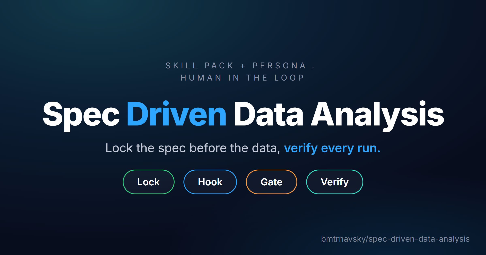

# A data analyst that shows its work



[](LICENSE)
[](https://hermes-agent.nousresearch.com/docs)
[](SPEC.md)

## What it does

This plugin makes an AI's data analysis checkable.

Ask an AI a data question and it answers with confidence. This plugin changes
the order of events. You write down the question, and how it will be answered,
before the data is opened. The analysis then runs through one controlled path,
and a reviewer with no memory of the work checks it before the result reaches
you.

It is for anyone who has to hand a number to another person and defend it,
without being a data engineer. It is a plugin for any data agent: built for
Hermes, and portable to any agent that can load skill files.

The thing being checked is not whether the model is clever. It is whether the
answer was chosen before or after the number appeared.

Sibling project:
[disciplined-vibe-coding](https://github.com/bmtrnavsky/disciplined-vibe-coding)
applies the same discipline to code: define before building, test before
shipping, verify before claiming done.

## How it works

One loop per question, or per milestone of a bigger analysis:

    Intake -> Define -> Economy + Tier -> Teardown -> LOCK -> Profile -> Analyze -> Verify -> Report -> Archive

In plain words:

**Before the lock** you and the agent work in the open. Research, read docs,
shape the question. Nothing is frozen yet and nothing is at risk.

**The lock is the hinge.** The spec — the question, the definitions, the
sources, and the plan for answering it — is fingerprinted and committed to git.
A fingerprint is a short code computed from the text, so any later edit changes
it. From that moment the question is fixed, and so is the evidence about it.

**After the lock the runner is closed.** Data reads go through a single
controlled path. Every run gets an id, and each version of the analysis script
(one version is called a variant) freezes the first time it runs. Research
access is gone, because the point is that you can no longer go looking for a
friendlier answer.

**The reviewer has no memory of the build.** The project calls it the goldfish.
At teardown, and again after results, a separate context reads a packet of
evidence and reports what it sees. It cannot edit the spec, cannot run
anything, and cannot approve its own work. Forgetting is the entire point.

**The evidence** lives in `.analysis/`. Each entry records its position in the
list and the fingerprint of the entry before it, and entries can only be added,
never edited. Change something in the middle and the chain says so.

Full pipeline, checkpoint table, and the reasoning behind each rule:
[SPEC.md](SPEC.md).

Every protection here is proven by a suite, not by reading the code: the fast
product tier (`python scripts/test.py fast`), the full run
(`python scripts/test.py full`, 425 tests green), the red-team harness
(`python redteam/run.py`, GREEN on the same tree), and the probe
certifications (`python -m tests.revert validate --matrix`).

What the loop refuses: no changing the question after seeing the answer, no
number that cannot be re-run, no self-grading by the builder, no dropped failed
approaches, no re-running until something looks green, no approval without a
recorded yes, no data reads around the runner, no chart without a path back to
a locked spec and a recorded yes.

## Stakes-aware, not one-size-fits-all

Every job gets a tier. **EXPLORE** means looking around, nothing at risk.
**DECIDE** means a choice gets made on this answer. **PUBLISH** means it goes to
someone else. The tier changes how much review is required, whether you have to
say yes first, and how deep the evidence chain has to be. A glance gets one line
of plan. A decision that costs real money gets the full chain and an independent
second opinion.

The agent does not get to set its own tier downward to skip the reviewer.
Setting it too low is the cheat that matters most, so it is the one the
checkpoints check hardest.

## You approve it, not the machine

The pipeline stops at every point where a person should be on the hook. The
pipeline calls these stops gates: the spec, the tier, the config, the report.
Nothing passes one on the agent's say-so.

Approving is plain. You say yes in chat. What gets recorded is the exact words
you said, who said them, when you said them, and the fingerprint of the exact
thing approved. That record is the approval. There is no password, no signing
key, no passphrase, and no second verification step.

The trade is deliberate, and it is written down in [SPEC.md](SPEC.md) §4.5.
Anyone who can run the command can write a record, so a record cannot prove who
typed it. What survives is the trail: the words, the speaker, the date, the
fingerprint, the commit, and a line in the evidence chain, so a deletion later
shows up.

Until you approve, the run parks and waits rather than guessing, and resumes
from the exact point it stopped.

## How to use it

Pick the seat that matches what you are allowed to do. The plugin is
bot-agnostic: same tools, different seat.

1. **Builder mode** runs the pipeline. Init, lock, run variants, pass the gates,
   publish the report:

   ```
   python scripts/dda.py init <workdir>
   python scripts/dda.py lock <workdir>
   python scripts/dda.py run --variant <id> [--workdir WD] variants/<id>.py
   python scripts/dda.py gate G4|G5|G2|G7 <workdir>
   ```

2. **QA-judge mode** verifies and does not build. Use a separate QA profile:
   read-only, no build tools, verdicts only, pinned model. Point it at a stage or
   a delta and let it re-check the evidence:

   ```
   python scripts/dda.py status
   python scripts/dda.py verify-chain <workdir>   # are the fingerprint chains intact?
   python scripts/dda.py verify <workdir>         # replay the locked script against the snapshot
   python scripts/dda.py gate G<n> <workdir>      # re-run the gate, read the verdict
   python scripts/dda.py doctor [workdir]         # environment and workdir health
   python redteam/run.py                          # GREEN = the preventions hold
   ```

   The judge never edits the spec, runs variants, or approves its own work.
   `lock --amend`, `run`, and `approve` belong to the builder seat.

3. **Combined pipeline.** The builder ships a stage, or the whole build, plus its
   `.analysis/` evidence. The QA seat replays `verify-chain` / `verify` / the
   relevant gate on the same commit and returns a verdict. A finding goes back to
   the builder as new work; the judge does not fix it inline.

## Install and first run

```bash
python scripts/dda.py install            # print the Hermes hooks block
python scripts/dda.py install --venv     # or install into a venv
python scripts/dda.py doctor             # interpreter, hooks, workdir health, heartbeat
```

Python 3.11 or newer, standard library only. A workdir must live inside a git
repo so it can lock. `config.yaml` is read by a strict YAML subset parser that
rejects anything it doesn't understand, on purpose.

Update an installed copy with `hermes plugins update spec-driven-data-analysis`.
Do not copy a folder over an install: that moves you off the reviewed version.

A short run end to end:

```bash
python scripts/dda.py init myanalysis
cd myanalysis
python scripts/dda.py start . --session $HERMES_SESSION_ID
# shape the question and write the spec, then:
python scripts/dda.py lock .
python scripts/dda.py run --variant baseline variants/baseline.py
python scripts/dda.py gate G5 . && python scripts/dda.py gate G2 .
python scripts/dda.py gate G3 .          # teardown review rounds + your yes in chat
python scripts/dda.py report .
python scripts/dda.py approve signoff --yes "yes, that's the answer" .   # quoted verbatim, in your own terminal
```

### Approving: a yes in chat, recorded

Approving is a two-step habit, and both steps are yours:

1. You say yes in chat. The agent shows you the exact command and fingerprint
   and waits. It never runs the approval itself, even when your message asks it
   to.
2. You run the command in your own terminal, quoting the words you said:

   ```bash
   python scripts/dda.py approve spec --yes "yes, lock it"
   python scripts/dda.py approve spec --yes "yes, lock it" --when 2026-11-22   # a yes from earlier
   python scripts/dda.py approved spec                                          # record the reading in the chain
   ```

`--who` defaults to the single approver named in `config.yaml`. A `--when` later
than the moment the record is written is refused: a yes cannot be said after
the record that captures it exists.

The agent's own claim is not an approval. Nothing passes a gate on the agent
saying the work is good.

Every command and every gate is documented in [SPEC.md](SPEC.md).

**What good output looks like:** `dda verify-chain` reports `chains: ok`,
`dda verify` replays the locked script against the snapshot and compares the
results, and `dda approved` reads the record back and prints the verdict for the
exact thing you approved. Until you approve, the run parks and waits rather than
guessing.

## Layout

    SPEC.md               the design, the checkpoint table, and the reasoning behind each rule
    scripts/dda.py        the CLI; Python >= 3.11, standard library only
    scripts/ddalib/       gates, chains, the runner, reviews, approvals
    scripts/dda.cmd       the same commands on Windows
    templates/            spec.md, config.yaml, goldfish-packet.md, wayfinder.md, correction case
    skills/correct/       the correction skill used by evals
    redteam/              phase-0 harness; GREEN means every prevention held
    tests/probes/         adversarial probes, each declaring the finding it expects
    tests/revert/         certifies each probe against the fix it is bound to
    hooks/                Hermes hook wiring
    docs/TESTING.md       what each test tier answers and when to run it

Engineers: gates, build phases, red-team history, and accepted risks live in
[docs/HARDENING.md](docs/HARDENING.md).

## License

MIT. See [LICENSE](LICENSE).
