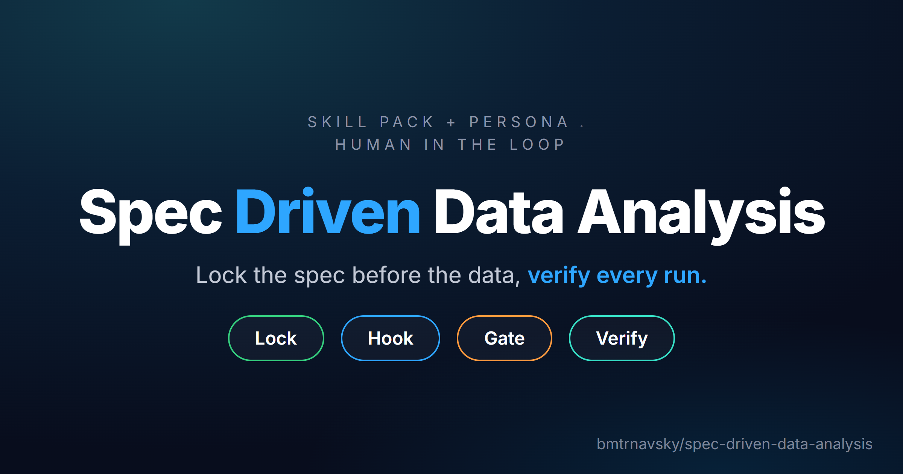

# Spec-Driven Data Analysis



[](https://hermes-agent.nousresearch.com/docs)
[](SPEC.md)

Part of the Disciplined series with
[disciplined-vibe-coding](https://github.com/bmtrnavsky/disciplined-vibe-coding)
— same house rules: lock the plan before the work, verify before claiming done.

Spec-first data analysis for Hermes: lock the plan before the data, block
the shortcuts with hooks, re-check every hook rule at a gate. The design is
in [SPEC.md](SPEC.md). This tree contains build phases 0–4 (SPEC §14).
Current build: `0.4.0-phase4` (`python scripts/dda.py version`).

## Status

| Phase | What | State |
|---|---|---|
| 0 | Red-team harness (`redteam/`) | built; GREEN on this install |
| 1 | Workdir layout, `dda` CLI skeleton, lock hashing, hook entry point, session binding | built |
| 2 | `dda lock` (git commit + ledger), hash-chained append-only logs with a locked appender, spill files and a heads mirror; lock-state cache; real `lockguard`, `evidenceguard`, `rawguard`, `defguard` (path rules), `footercheck` (recomputable fields), `runlog` + heartbeat; unbound-access log; G4 | built |
| 3 | Kernel runner with audit hook, native lockdown and reader wrappers, `dda meta`, variants with freeze-on-first-run, specs-tried ledger, and the orphan check (G6) | built |
| 4 | `dda doctor` (interpreter, hooks, approver keys, workdir, heartbeat), signed approvals (`dda approve` / `dda approved`, approver chain, config approval at G4), footer approval fields | built |
| 5–9 | `dda gitcheck`, full `footercheck` and `report` (5); definitions and content-hashed pins (6); goldfish review, `dda packet` / `dda review` (7); `dda verify` / `dda profile` (8); `correct` and `dda evals` (9). Gates G0–G3, G5, G7–G9 also arrive here | not built; commands fail closed (exit 3) |

The CLI is `dda` (pronounced "dee-dee-ay", short for disciplined data analysis).

## Use

```
python scripts/dda.py init <workdir>          # layout + templates
python scripts/dda.py hash <workdir> [--json] # lock hash of the current spec (no side effects)
python scripts/dda.py start <workdir> --session <id>   # bind a session (default: $HERMES_SESSION_ID)
python scripts/dda.py status
python scripts/dda.py release <workdir>
python scripts/dda.py install [--venv]        # print the Hermes hooks block
python scripts/dda.py lock <workdir> [--amend "<reason>"]   # lock (or amend) the spec; git commit
python scripts/dda.py verify-chain <workdir> [--json]       # merge spills, verify every chain (exit 4 = broken)
python scripts/dda.py gate G4 <workdir>       # lock recompute, chain verify, exposure scan, relabel
python scripts/dda.py gate G6 <workdir>       # orphan runs, frozen bodies, ledger reasons, heartbeat
python scripts/dda.py meta <alias> [workdir] [--session S]   # metadata only: names, types, counts
python scripts/dda.py variant <id> [workdir] --why "..." [--parent P] [--label L] [--set k=v ...]
python scripts/dda.py variant --locked <id> [workdir]  # mark the reported variant
python scripts/dda.py variant --list [workdir]
python scripts/dda.py run --variant <id> [--seed N] [--workdir WD] variants/<id>.py [-- args...]
python scripts/dda.py footer <workdir> [--check FILE] [--short]
python scripts/dda.py abandon <workdir> --reason "..."
python scripts/dda.py approve <kind> [artifact] [workdir] [--key K] [-m "..."]  # signed human approval; run in your own terminal
python scripts/dda.py approved <kind> [artifact] [workdir]  # verify an approval, record the verdict
python scripts/dda.py doctor [workdir] [--json]  # interpreter, hooks, approver keys, workdir, heartbeat
python scripts/dda.py version
```

Evidence lives in `.analysis/` (`ledger.md`, `runs.log`, `audit.log`,
`specs-tried.jsonl`, `approvals.index.jsonl`; one canonical-JSON record per
line, each carrying `seq` and the SHA-256 of the previous line) and in dda
home (`heads/` mirror, `state/` lock-state cache, `heartbeat/<session>.log`,
`unbound-access.log`). A workdir must be inside a git repo to lock.

`scripts/dda.cmd` wraps the same on Windows. Everything is stdlib-only
Python ≥ 3.11; `config.yaml` is read by a strict YAML subset parser that
rejects anything it doesn't understand.

## Tests

```
python -m unittest discover -s tests      # phase-1 to phase-4 unit tests
python redteam/run.py [--json out.json]   # phase-0 red-team; exit 0 = GREEN
```

The red-team harness never touches the live Hermes profile: it points
`DDA_HOME` and `HERMES_HOME` at a scratch directory and drives Hermes's own
`agent.shell_hooks.run_once` from the hermes-agent venv. GREEN means every
expected prevention held, no unbound-session false positive, and every miss
is a documented caveat in [redteam/threat-model.md](redteam/threat-model.md).

## Before installing the hooks

Phase 3's sanctioned path is real: after lock, data reads go through
`dda run` (the locked-down kernel, `dda variant` ids, freeze-on-first-run)
and declared connector tools; `dda meta` is the only metadata peek.
Config approval at G4 is built: G4 fails closed at DECIDE/PUBLISH without a config approval for the exact config hash, passes with disclosure on an unverified one at DECIDE, and discloses unapproved config at EXPLORE.
