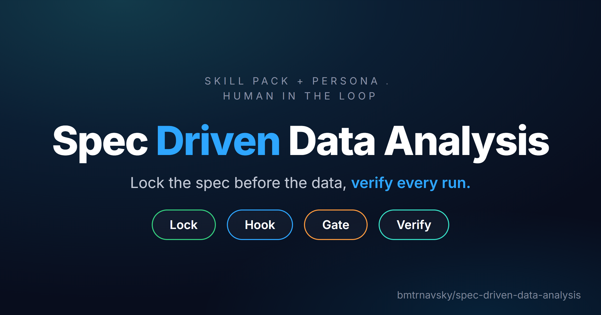

# A data analyst that shows its work



[](LICENSE)
[](https://hermes-agent.nousresearch.com/docs)
[](SPEC.md)

A lean plugin for any data agent (built for Hermes; portable to any agent that
can load skills). For someone who has to hand a number to another human and
defend it, without being a data engineer.

You ask an AI to analyze something and it answers confidently. This plugin makes
it answer *provably*. The question gets locked before the data is touched, the
analysis runs in a sealed kernel, and a reviewer with no memory of the build
checks the work before you see it.

This isn't about getting better answers out of a model. It's about being able to
tell whether the answer was chosen before or after the number.

Sibling project:
[disciplined-vibe-coding](https://github.com/bmtrnavsky/disciplined-vibe-coding)
applies the same discipline to code: define before building, test before
shipping, verify before claiming done.

## Status

Current build: `0.9.1-phase9` (`python scripts/dda.py version`).
All ten build phases (SPEC §14) are implemented; anything else fails closed.

| Phase | Scope | State |
|-------|-------|-------|
| 0 | Red-team harness (`redteam/run.py`; GREEN = every prevention held) | built |
| 1 | Templates, config, `init` / `start` / `release`, hook entry | built |
| 2 | `lock`, chained evidence logs, `runlog`, `lockguard` / `evidenceguard` | built |
| 3 | Kernel runner, `meta` / `variant` / `run`, gate G6 | built |
| 4 | Approvals (`approve` / `approved`), `doctor`, gate G4 | built |
| 5 | `footercheck`, `footer --check`, `report`, `gitcheck`; gates G0, G8, G9 | built |
| 6 | `definitions`, `defguard`, content-hashed pins; gate G1 | built |
| 7 | Goldfish packet, `review run`, gate G3 | built |
| 8 | `profile` / `verify`, gates G2, G5, G7 | built |
| 9 | `correct`, `evals` | built |

Last verification (commit `ebe5274`): fast tier 322 tests green, premise
check FRESH, `redteam/run.py` GREEN (94 prevented, 30 detected, 1 documented
environmental miss: no hermes-agent checkout on this host), `dda
verify-chain` reports `chains: ok`.

## The loop

    Intake -> Define -> Economy + Tier -> Teardown -> LOCK -> Profile -> Analyze -> Verify -> Report -> Archive

One loop per question, or per milestone of a bigger analysis. Ten stages, each
with a gate that has to pass before the next one opens.

**Before the lock** you and the agent work in the open: research, read docs,
shape the question. Nothing is frozen yet and nothing is at risk.

**The lock is the hinge.** The spec is hashed and committed to git. From that
moment the question is fixed, and so is the evidence about it.

**After the lock the kernel is sealed.** Data reads go through one controlled
path, run ids are recorded, and a variant freezes the first time it runs.
Research access is gone, because the point is that you can no longer go looking
for a friendlier answer.

**The goldfish is the review.** At teardown, and again after results, a separate
context with no memory of the build reads a packet of evidence and reports what
it sees. It cannot amend the spec, cannot run anything, and cannot approve its
own work. Forgetting is the entire point.

**The evidence** lives in `.analysis/` as append-only logs where every line
carries its sequence number and the hash of the line before it. Alter something
in the middle and the chain tells on you.

Full pipeline, gate table, and the reasoning behind each rule: [SPEC.md](SPEC.md).

## What it actually stops you from doing

- Changing the question after seeing the answer. The spec is hashed and
  committed; amend it and the hash breaks, loudly.
- Reporting a number whose analysis cannot be re-run. `dda verify` replays the
  locked script against the snapshot and compares.
- Letting the same mind that built the work grade it. The reviewer never saw the
  build and has no tools to fix it.
- Quietly dropping the two approaches that did not work. Every variant is
  declared with a reason, and the ledger keeps the ones that failed.
- Re-running until something looks green and calling that done. Review rounds
  are capped and recorded.
- Reusing your approval for a different artifact than the one you approved. Edit
  the output after signoff and it goes stale.
- Reading data around the kernel, so "what did you actually run" has no answer.
- Handing you a chart with no path back to a locked spec and a signed approval.

## Stakes-aware, not one-size-fits-all

Every job gets a tier: **EXPLORE** (looking around, nothing at risk), **DECIDE**
(a choice gets made on this), or **PUBLISH** (it goes to someone else). The tier
changes how much review is required, whether you sign off, and how deep the
evidence chain has to be. A glance gets one line of plan. A decision that costs
real money gets the full chain and an independent second opinion.

The agent does not get to set its own tier downward to skip the reviewer. Setting
it too low is the cheat that matters most, so it is the one the gates check
hardest.

## You approve it, not the machine

The pipeline stops at every point where a person should be on the hook: the
spec, the tier, the config, the report. Nothing passes those gates on the
agent's say-so.

At the machine, your key signs the approval, so the record shows a human was
present. Away from it, a confirmation from your phone is enough, taken on the
authenticated account and recorded against the exact thing approved. Either way
the record says which.

Until you approve, the run parks and waits rather than guessing, and resumes
from the exact point it stopped.

## Ways to use this

The plugin is bot-agnostic: same tools, different seat. Pick the seat that
matches what you are allowed to do.

1. **Builder mode** runs the pipe. Init, lock, run variants, pass the gates,
   publish the report:

   ```
   python scripts/dda.py init <workdir>
   python scripts/dda.py lock <workdir>
   python scripts/dda.py run --variant <id> [--workdir WD] variants/<id>.py
   python scripts/dda.py gate G4|G5|G2|G7 <workdir>
   ```

2. **QA-judge mode** verifies and does not build. Use a separate QA profile:
   read-only, no build tools, verdicts only, pinned model. Point it at a stage or
   a delta and let it re-check the evidence:

   ```
   python scripts/dda.py status
   python scripts/dda.py verify-chain <workdir>   # hash chains intact?
   python scripts/dda.py verify <workdir>         # replay locked script vs snapshot
   python scripts/dda.py gate G<n> <workdir>      # re-run the gate, read the verdict
   python scripts/dda.py doctor [workdir]         # environment + workdir health
   python redteam/run.py                          # GREEN = preventions hold
   ```

   The judge never amends the spec, runs variants, or approves its own work.
   `lock --amend`, `run`, and `approve` belong to the builder seat.

3. **Combined pipeline.** The builder ships a stage, or the whole build, plus its
   `.analysis/` evidence. The QA seat replays `verify-chain` / `verify` / the
   relevant gate on the same commit and returns a verdict. A finding goes back to
   the builder as new work; the judge does not fix it inline.

## Layout

    SPEC.md               the design, the gate table, and the reasoning behind each rule
    scripts/dda.py        the CLI; stdlib-only Python >= 3.11
    scripts/ddalib/       gates, chains, kernel runner, reviews, approvals
    scripts/dda.cmd       the same commands on Windows
    templates/            spec.md, config.yaml, goldfish-packet.md, wayfinder.md, correction case
    skills/correct/       the correction skill used by evals
    redteam/              phase-0 harness; GREEN means every prevention held
    tests/probes/         adversarial probes, each declaring the finding it expects
    tests/revert/         certifies each probe against the fix it is bound to
    hooks/                Hermes hook wiring

## Install

```bash
python scripts/dda.py install            # print the Hermes hooks block
python scripts/dda.py install --venv     # or install into a venv
python scripts/dda.py doctor             # interpreter, hooks, approver keys, workdir, heartbeat
```

Stdlib-only Python 3.11 or newer. A workdir must live inside a git repo so it can
lock. `config.yaml` is read by a strict YAML subset parser that rejects anything
it doesn't understand, on purpose.

A short run end to end:

```bash
python scripts/dda.py init myanalysis
cd myanalysis
python scripts/dda.py start . --session $HERMES_SESSION_ID
# shape the question and write the spec, then:
python scripts/dda.py lock .
python scripts/dda.py run --variant baseline variants/baseline.py
python scripts/dda.py gate G5 . && python scripts/dda.py gate G2 .
python scripts/dda.py gate G3 .          # teardown review rounds + human approval
python scripts/dda.py report .
python scripts/dda.py approve report answer.md .   # signed, in your own terminal
```

### Approving: desktop or Telegram

Every approval is yours, made one of two ways. Both count the same at every
tier, PUBLISH included:

- **At the desktop**, `dda approve <kind>` signs the commit, so git asks for your
  key passphrase (or a FIDO touch). `dda approved` prints
  `VERIFIED - signed by brad`.
- **On Telegram**, your signed-in account is the proof, and there is no
  passphrase. You confirm the kind and digest in the chat, and the approval is
  recorded with `dda approve <kind> --telegram <your_user_id> <message_id>`.
  `dda approved` prints `CONFIRMED - Telegram user 8919091876, message 8441`.
  The message id is stored verbatim so you can check it against the chat later.
  Your user id must be listed as `telegram_user_id` on an approver in
  `config.yaml`.

`--no-sign` is neither. It records an UNVERIFIED approval, which is the agent's
own claim: shown as a disclosure below PUBLISH, and refused at PUBLISH.

Every command and every gate is documented in [SPEC.md](SPEC.md).

## Tests

```bash
python scripts/test.py fast    # routine product tier (~40 min, 319 tests)
python scripts/test.py check   # premise-staleness gate (seconds): FRESH means fast is enough
python scripts/test.py full    # certification + product (~2 hours; before a handoff)
```

See [docs/TESTING.md](docs/TESTING.md) for what each tier answers and when to run it. Quick reference of the older commands:

```bash
python redteam/run.py [--json out.json]                # red-team; exit 0 = GREEN
python -m tests.revert validate --matrix               # certify probe/anchor bindings
python -m tests.revert selfcheck                       # repair a tree left by a killed run
```

`tests/probes/` holds adversarial probes, and `tests/revert/` certifies each one
by reverting the fix it is bound to and requiring the probe to flip. A probe that
would pass either way fails certification instead of quietly proving nothing.
Reverts run on a temporary copy under a lock, never on your checkout.

The red-team harness never touches a live Hermes profile. It points `DDA_HOME`
and `HERMES_HOME` at a scratch directory and drives Hermes's own
`agent.shell_hooks.run_once`. GREEN means every expected prevention held, no
unbound-session false positive, and every miss is a documented caveat in
[redteam/threat-model.md](redteam/threat-model.md).

## Before installing the hooks

Phase 3's sanctioned path is real: after lock, data reads go through `dda run`
(the locked-down kernel, `dda variant` ids, freeze-on-first-run) and declared
connector tools. `dda meta` is the only metadata peek. Config approval at G4 is
built and fails closed at DECIDE and PUBLISH without an approval for the exact
config hash.

## License

MIT. See [LICENSE](LICENSE).
